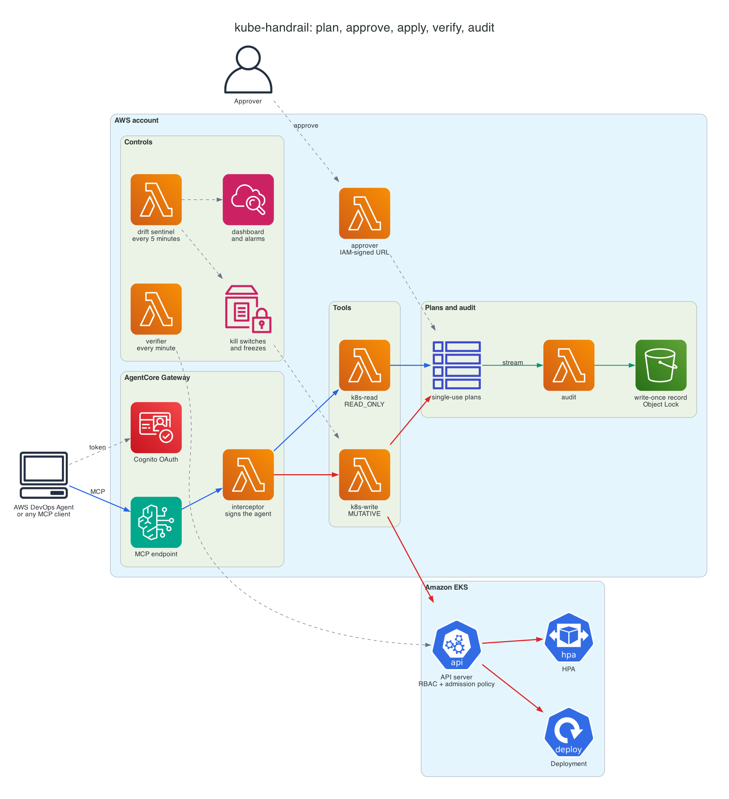
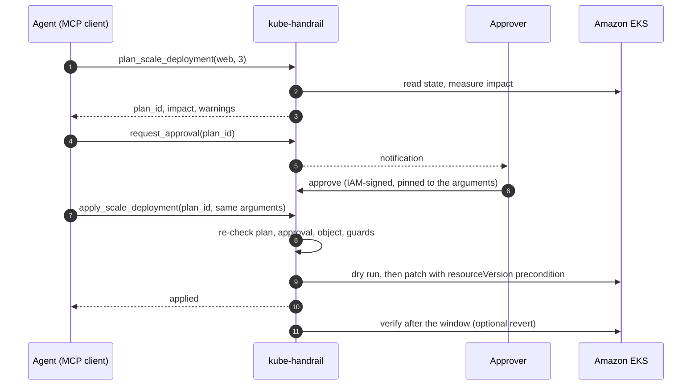

# kube-handrail

**Guarded Kubernetes changes for AI agents: plan → approve → apply → verify → audit.**

kube-handrail is a set of MCP tools for Amazon EKS that lets an AI agent scale, restart, roll back and tune the autoscaling of Deployments, and nothing more, through single-use plans that a human approves and the server enforces. It is built for AWS DevOps Agent and works with any MCP client.

## Why

AI agents are good at *investigating* Kubernetes problems. Letting them *write* to a cluster safely is the gap.

- **DevOps Agent's native EKS access is read-only.** It "cannot create, modify, or delete any resources in your cluster" ([EKS access setup](https://docs.aws.amazon.com/devopsagent/latest/userguide/configuring-integrations-and-knowledge-aws-eks-access-setup.html)).
- **Custom MCP tools can write, but only through directed actions.** A `MUTATIVE` tool needs per-action operator approval in chat; a `DESTRUCTIVE` tool is never invoked ([Directed actions](https://docs.aws.amazon.com/devopsagent/latest/userguide/working-with-devops-agent-working-with-directed-actions.html)).
- **Unclassified tools default to `READ_ONLY`.** One missed classification turns a write tool into an unapproved write tool.
- **Tool output is an injection surface.** AWS recommends that custom MCP servers be read-only ([DevOps Agent security](https://docs.aws.amazon.com/devopsagent/latest/userguide/aws-devops-agent-security.html)). Write tools depart from that knowingly; the server-side controls below compensate.

The approval in the client is necessary but not enough. kube-handrail enforces limits on the server, so that a misclassified tool, a misconfigured client or a prompt-injected agent still cannot make an unbounded change.

## How it works

The flow in `both` mode, where the chat also asks the operator before the apply; in `server` mode the approval runs the apply.

1. **Plan.** A read-only `plan_*` tool checks namespace policy, bounds, GitOps and HPA ownership, blast radius and the oscillation breaker, measures the impact (pods, PodDisruptionBudget headroom, Service endpoints) and stores a single-use plan pinned to the object's `uid` and spec.
2. **Approve.** A listed human approves through an IAM-authenticated API outside MCP (`scripts/approve.py`), pinned to the plan's exact arguments, or in the client's chat, depending on the [approval mode](#approval-modes).
3. **Apply.** The write Lambda re-checks everything: plan unexpired and unused, arguments identical, approval valid and not by the requester, object unchanged, kill switches on, breaker and budgets within limits. Then a server-side dry run and a patch with a `resourceVersion` precondition.
4. **Verify.** After the plan's window the server reports `healthy`, `degraded` or `unknown`. A `degraded` change approved with `revert_on_failure` is set back once.
5. **Audit.** A correlation ID links the plan record, the object, the logs and the EKS audit log; every change to a plan record is written once to an S3 bucket with Object Lock that the executor cannot alter.

## Tools

| Tool | Classification | Purpose |
|---|---|---|
| `get_workload_status`, `get_workload_events`, `get_rollout_history` | `READ_ONLY` | Summaries that serve the plan: replicas, conditions, cleaned events, revisions |
| `plan_scale_deployment`, `plan_restart_deployment`, `plan_rollback_deployment`, `plan_adjust_hpa` | `READ_ONLY` | Check every guard, preview the impact, store a single-use plan |
| `request_approval`, `get_plan_outcome` | `READ_ONLY` | Ask the approvers; read the approval, result and verification |
| `apply_scale_deployment`, `apply_restart_deployment`, `apply_rollback_deployment`, `apply_adjust_hpa` | `MUTATIVE` | Apply an approved plan with the planned arguments |

The exact rules for every tool, error code and guard are in [`mcp/CONTRACT.md`](mcp/CONTRACT.md); the agent instructions are in [AGENTS.md](AGENTS.md).

## Safety model

- **Plan/apply split.** Every write is a `READ_ONLY` `plan_*` and a `MUTATIVE` `apply_*` with identical arguments, so the approver sees real values.
- **Misclassification loses the approval, not the limits.** The server limits hold for any classification, and the drift sentinel turns the kill switch off when a write tool stops being `MUTATIVE`.
- **Defense in depth:** the guard in the write Lambda (authoritative), namespace-scoped RBAC, a ValidatingAdmissionPolicy for the bounds, server-verified approval and the client's approval.
- **Bounded blast radius:** replica bounds and allowed actions per namespace, a maximum step per change, cooldown, flapping detection, per-object, per-agent and global hourly budgets, kill switches and change freezes.
- **Accountable agents:** the gateway interceptor signs which agent called; an agent cannot apply another agent's plan, and each agent has its own budget and kill switch.
- **GitOps-aware:** objects owned by Argo CD or Flux are refused; the change belongs in Git.
- **No delete-class tools**, no generic `apply_yaml`.
- **Untrusted output:** cluster text is cleaned, redacted, cut and wrapped in `<untrusted>` before an agent sees it.

Why each check exists: [Guards](docs/guards.md).

## Approval modes

| Mode | Who approves | Use it for |
|---|---|---|
| `server` (default) | A listed approver through the IAM-signed approval API; the approval runs the apply | An audit-grade record of who approved |
| `both` | The approver on the server, then the operator in the DevOps Agent chat | Production with DevOps Agent |
| `client` | The operator in the chat only | Evaluation; CloudTrail cannot bind a chat approval to a plan |

For production, also set the audit bucket to `COMPLIANCE` ([Approval mode](docs/deploy.md#approval-mode), [Audit record retention](docs/deploy.md#audit-record-retention)).

## Get started

1. [Quickstart](docs/quickstart.md): deploy, run the smoke test, connect DevOps Agent.
2. [Deploying to a new account](docs/deploy.md): prerequisites, namespaces, agents, approval mode, network, upgrades with `make upgrade`.
3. [Testing](docs/testing.md): the integration suite, the end-to-end guard tests and the DevOps Agent checks.

Requires Kubernetes 1.30 or later for the admission policy and Terraform 1.5 or later; see [Releasing](docs/releasing.md) for supported versions.

## Scope

kube-handrail is not an AI SRE agent: investigation belongs to the MCP client ([ADR 0001](docs/adr/0001-scope.md)). It adds no generic Kubernetes or CloudWatch read tools that duplicate the Amazon EKS MCP server or DevOps Agent, and no write without a human approval pinned to its arguments ([ADR 0002](docs/adr/0002-server-verified-approval.md)). Cedar policies at the gateway, break-glass and a signed audit ledger are on the [roadmap](docs/roadmap.md).

## Documentation

- [`mcp/CONTRACT.md`](mcp/CONTRACT.md) and its appendices: tools, errors, plan record, guards, limits and configuration, for example [Drift sentinel](mcp/CONTRACT.md#drift-sentinel), [Approval API](mcp/contract/approval-api.md) and [Untrusted output](mcp/contract/untrusted-output.md).
- ADRs: [0001 Scope](docs/adr/0001-scope.md), [0002 Server-verified approval](docs/adr/0002-server-verified-approval.md), [0003 Agent identity](docs/adr/0003-agent-identity.md), [0004 Pre-approved revert](docs/adr/0004-pre-approved-revert.md), [0005 Change freezes](docs/adr/0005-change-freezes.md), [0006 Admission policy](docs/adr/0006-admission-policy.md), [0007 Durable audit record](docs/adr/0007-durable-audit-record.md).
- [Roadmap](docs/roadmap.md), [Milestones done](docs/history/milestones.md), [CHANGELOG.md](CHANGELOG.md), [Releasing](docs/releasing.md).

The architecture diagram is drawn from [`docs/diagrams/architecture.py`](docs/diagrams/architecture.py).

## Contributing

Issues and pull requests are welcome, especially feedback on the safety model, the policy structure and the scope. See [CONTRIBUTING.md](CONTRIBUTING.md) and the [Code of Conduct](CODE_OF_CONDUCT.md). Report vulnerabilities privately as described in [SECURITY.md](SECURITY.md).

## License

Apache License 2.0. See [LICENSE](LICENSE).
